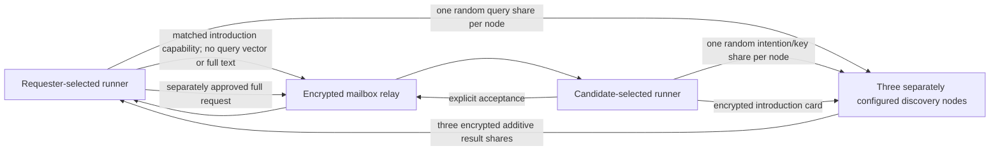

# Experimental shared candidate index

Originating vision: Rima Al Shikh · Begin AI. Synthetic-only implementation, 15 October 2026.

This adds the missing path between an intention and an unfamiliar counterpart. A requester starts with **zero counterpart keys**. A private three-node index compares protected candidate representations, conditionally releases a one-use introduction, and feeds the existing participant runtime's proposal → acceptance → explicit disclosure → reply/follow-up path. The counterpart does not receive the query vector on this path. The older owner-local method remains available with its different disclosure contract.

The implementation is a bounded experimental linear scan, not a scalable global nearest-neighbour service. It uses MPyC 0.11's passive honest-majority security model: at most **one of three** computation nodes may observe its state while following the protocol. It does not provide malicious security, anonymous membership, a general computation proof, or a P2 pass. [MPyC's primary documentation](https://github.com/lschoe/mpyc) states the underlying threshold-sharing assumptions; the [threshold sharing and runtime APIs](https://mpyc.readthedocs.io/en/latest/mpyc.html) supply the sharing and computation primitives. The dependency is pinned by wheel hash in `experiments/mpc/requirements.txt`.

## Data path



1. The owner creates a Mirror, Window or Social intention in the original store. Facts, aspirations and agent inferences stay distinct. The locally selected encoder produces an L2-normalized vector. Purpose and task role remain separate: a Window is an aspiration or unfamiliar direction, not a synonym for seeking help.
2. The owner explicitly chooses a discovery pool and creates a short-lived, one-use contact capability. The signed card binds the owner's signing identity and encryption key. Invitation and thread lifetimes cannot exceed either participant's remaining availability. The runner retains the intention revision and representation digest; edit, retirement, model change, expiry, pool removal or local revocation invalidates later contact/disclosure.
3. The owner's adapter seals that card to a fresh opening key. MPyC's Shamir sharing splits the quantized vector, purpose, complementary role, availability, exploration floor, willingness bit and opening key into three shares. Each node receives one share and the ciphertext. A fresh per-record update signing key authorizes updates/withdrawal without publishing the owner's persistent address.
4. Nodes persist private shards in separate SQLite files. These are **not public discovery-index entries**. The public bootstrap index contains method/service metadata only and still advertises zero operating nodes. Pool signers, network addresses, source hashes and allowed query signers are operator-selected independently of advertisements. No Begin signing root is required.
5. The requester similarly shares its representation and constraints. Its signed session consent and all three node consents bind the exact snapshot, individual query-share digests, method/model, source hashes, parties, output recipient and expiry. Each worker checks its own local configuration before connecting. Node-to-node computation uses verified mutual TLS, with separate keys and a pool-specific test CA.
6. The fixed circuit scans every compatible record. It checks coordinate/norm ranges, exact purpose, complementary roles, overlapping time, consent and both parties' minimum relevance thresholds. A requester can broaden exploration only within the candidate's own floor. Each purpose-bound record is independent; this is not yet a learned cross-purpose combination of Mirror/Window/Social representations.
7. A positive predicate gates the encrypted introduction's opening key. A negative result gates it to zero. The circuit outputs no score, vector or ranking. Before release, nodes convert results into fresh **three-of-three additive shares** using independent full-field masks. Raw two-of-three Shamir result shares are never sent to the requester. Each node signs its result, encrypts it to the requester, and durably caches it. The requester needs all three releases to reconstruct the result.
8. The requester verifies all three independently pinned signatures, session binding and ciphertext digests, then reconstructs matching cards. A card authenticates a key and permits one contact; it is a bearer capability, **not proof of a person's identity or correct semantic computation**. A holder can share it; neither collusion nor dishonest holders are defeated by the endpoint API.
9. `begin_contact_discovered` sends a signed encrypted introduction. An unknown sender key can attempt only this message type and must present a valid, unused capability held by the recipient. Ordinary matching queries cannot use this bootstrap exception. A verified introduction creates a proposal, never permission to open the full request. The recipient must accept; the requester must separately disclose. Existing encrypted reply, follow-up, durable mailbox, retry and acknowledgement behavior then applies.

## What each role can observe

| Role | Receives or can infer |
| --- | --- |
| Participant's selected runner | Its owner's full intentions, keys and representations. The operator must be trusted; phone-local execution is not claimed. |
| One passive discovery node | One share per value, encrypted cards, opaque stable record/update identifiers, method/model/dimension, record count/revision/expiry, requester key, query timing and budget usage. The prescribed computation does not open vectors, match bits or introduction identities there. |
| Two colluding discovery nodes | Can reconstruct stored Shamir-shared inputs and opening keys. This breaks the stated one-corruption assumption. Three-of-three output masking does not repair collusion among input holders. |
| Requester | Match/no-match per opaque snapshot row, matching identities and contact capabilities. Repeated predicates are an information oracle. No score or candidate vector is returned. |
| Candidate | Requester's key after contact, then full text only after both disclosure steps. Receives no query representation from this method. |
| Relay | Registered sender/recipient keys, timing, sizes and delivery metadata. Sealed payloads, no participant decryption keys. |
| Public index publisher | Public methods and volunteered service advertisements. No private vector, intention or roster is placed there. |

This is not protected membership in the strongest sense: nodes see opaque enrollment records and counts, an enrollment transport could link a record to a source, and the requester sees opaque row-level outcomes. There is no padding, oblivious access, anonymous enrollment, traffic mixing or proof against inference. A scan avoids a data-dependent access path, but that alone does not solve these leaks.

## Persistence, withdrawal and availability

Each node admits at most three sessions per locally approved query signing key in this experimental pool. Reservations survive restart; a failed/incomplete session remains charged and fails closed. Completed retries return the same encrypted output without rerunning comparison. A new key, a different pool or colluding requesters can bypass that local aggregate bound; this is not Sybil resistance or a global budget system. The fixture has at most eight lifetime record slots, including tombstones.

Signed record updates bind their original update key and increase revisions. A different signer, rollback or conflicting same revision is rejected. Withdrawal removes shares/card ciphertext from the current record and retains its ownership/revision tombstone. Expired records are logically cleared when inspected. No forensic erasure or backup deletion is promised. Nodes check current snapshots before admission and again before releasing a result; local finalization is transactional.

Index withdrawal must reach all selected nodes. An already released result cannot be revoked from a requester's memory. The participant's own invitation revocation independently blocks subsequent contact, acceptance and incoming disclosure, even if stale index data remains elsewhere. A withdrawal racing a computation can prevent completion; there is no distributed atomic withdrawal protocol or guaranteed revocation of an already released identity.

All three nodes are required for a successful search. Loss of one stops the run within a bounded timeout; the runtime never lowers its threshold. A participant can independently enroll fresh shares with another selected three-node pool. That is whole-pool replacement, not transparent one-node repair or private share migration. The test demonstrates an independently keyed alternate pool after a failure, not independent administration of real hosts.

## Executed evidence

`experiments/shared_index/results.json` records the source hashes, measured subprocess IDs/timing/bytes and passing acceptance cases. `model-results.json` records a local, pinned 384-dimensional MiniLM run on two synthetic intentions. The private calculation returned `[true, false]`, matching its quantized plaintext predicate. The model manifest was verified before loading; no model was downloaded. This measures arithmetic equivalence, **not real-world relevance or representation fidelity**. The new tagged-intention method still needs an independent labeled semantic evaluation.

`tests/test_runtime_mcp.py::test_unfamiliar_mcp_participants_shared_index_and_https_relay` exercises two official-SDK MCP participant servers, three separate discovery processes and a separate HTTPS relay. Both participants begin with empty counterpart rosters. The harness obtains owner consent through MCP, supplies each node only its share, reconstructs the matching card, invokes the introduction tool, rejects early disclosure, then verifies acceptance, request, reply, both participant restarts, a related follow-up and acknowledgements. No full description is stored in the relay. Relay account registration is separately provisioned by the synthetic operator; it is not a network-wide identity authority.

The same unfamiliar-participant MCP test also passed with the pinned local MiniLM encoder in both participant servers, including recovery after their restart. This exercises the complete model → protected scan → introduction → approved request → reply/follow-up path, without establishing real-world matching quality.

The experiment controller knows every synthetic fixture, provisions all test keys/certificates, and can access all files under the same OS account. Private enrollment/query submission and session scheduling are local harness operations, **not deployed remote service APIs**. The mutual TLS computation and HTTPS relay use real sockets; this still does not demonstrate separate machines, independent administrators or actual ChatGPT/Claude product calls.

## Run it

Use the documented core environment plus the optional hash-locked MPC dependency:

```sh
python -m pip install --require-hashes -r requirements.lock
python -m pip install --require-hashes -r experiments/mpc/requirements.txt
python -m pip install --no-deps .
python experiments/shared_index/run.py --report /tmp/begin-shared-index-results.json
```

For the six-process MCP exchange, use Python 3.12 and install `requirements-client.lock` plus the same MPC lock, then run:

```sh
python -m unittest discover -s tests -p test_runtime_mcp.py -v
```

An optional real-model check accepts the existing local model manifest:

```sh
HF_HUB_OFFLINE=1 TRANSFORMERS_OFFLINE=1 python experiments/shared_index/run_model.py \
  --model-config /operator/path/model-config.json --report /tmp/begin-shared-model-results.json
```

The manifest supplies `directory` and exact `file_hashes` for the pinned MiniLM model; install the separately locked embedding dependencies first. Neither paths nor trust pins are accepted from incoming network text.

## Remaining work before live use

Provide authenticated enrollment/query/coordination APIs and durable scheduling for independently operated hosts; select and review the stronger adversary model and key-release composition; protect membership/traffic and address probing/admission; benchmark scalable search and useful multilingual/exploratory matching; then bind real client authentication to participant-selected remote runners. Existing ChatGPT/Claude clients must use those remote tools without installing a new end-user runtime. The old Sites plugin has not been migrated. This commit does not pass the complete P1–E4 gates or authorize real personal data.
